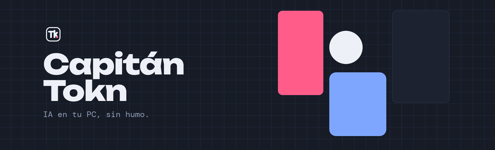
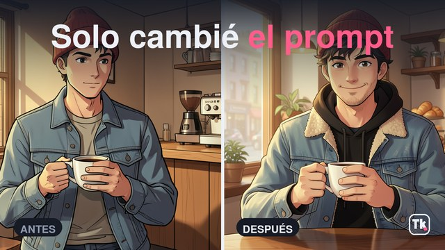

**Vídeo e imagen con IA en una gráfica normal, con datos medidos.** · [Canal de YouTube](https://www.youtube.com/@CapitanTokn)

Capitán Tokn es un canal de laboratorio: pruebo IA generativa en local, en una RTX 4070 de 12 GB, y cuento lo que funciona, lo que falla y por qué. Sin tutoriales de dos horas: cualquier IA te guía en la instalación. Aquí está lo que la IA no sabe, porque no lo ha roto ella.

Si no está medido, no se dice.

### Último vídeo

**[Tu PC hace imágenes como ChatGPT (si se lo pides bien)](https://youtu.be/nw4dVtujfNM)** · 4 modelos de imagen en local contra ChatGPT y Gemini, medidos, y un caso real de la idea al clip.

### Workflows de los vídeos

| Vídeo | Repositorio |
| --- | --- |
| [Tu PC hace imágenes como ChatGPT (si se lo pides bien)](https://youtu.be/nw4dVtujfNM) | [imagen-perfecta-12gb](https://github.com/Capitan-Tokn/imagen-perfecta-12gb): FLUX.2 klein y Z-Image Turbo en ComfyUI, y la receta del prompt en 7 partes |
| [Vídeos con IA GRATIS en tu PC (solo 12 GB de VRAM)](https://youtu.be/YHKaT_bc_ck) | [wan22-12gb-vram](https://github.com/Capitan-Tokn/wan22-12gb-vram): Wan 2.2 en ComfyUI, con un clip para arrastrar y que se monte solo |

Todo en local, con modelos abiertos. Si algo cuesta dinero, se dice.
